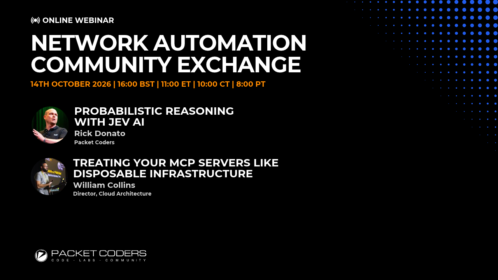

# Packet Coders Meetup 2026



A live demo of [gridctl](https://github.com/gridctl/gridctl), an MCP gateway that turns a single YAML file into a running set of MCP servers, for network and infrastructure engineers who already think in `terraform plan` and Containerlab.

## Event

| | |
|---|---|
| Host | [Packet Coders](https://www.packetcoders.io/) |
| Format | Remote meetup over Zoom webinar |
| Registration | [Register here](https://us02web.zoom.us/webinar/register/WN_O71SU9PjTIydlSP_fzYvlg#/registration) |
| Speaker | William Collins |

The session opens with a short slide intro, moves to hands-on work in the terminal, and closes with a few slides.

## What is in this repo

| Path | Purpose |
|---|---|
| `stack.yaml` | The demo stack. Step one is live; the remaining servers and the access-control blocks are commented out and enabled one at a time |
| `local-time/` | Dockerfile for the optional local-source build example |

## Requirements

- [gridctl](https://github.com/gridctl/gridctl) 1.0.0-rc.2 or later
- Docker, running, with permission to pull images
- An MCP client to link against: [OpenCode](https://opencode.ai) or Claude Code
- Node.js 18 or later and Google Chrome, only for the Playwright server
- Internet access for the remote, PyPI, and OpenAPI servers

Python is not needed on the host. The `fetch` and `calculator` servers build and run inside containers.

## Run the stack

```sh
gridctl plan stack.yaml
gridctl apply stack.yaml
gridctl status
```

`plan` previews what will be created, like `terraform plan`. Once the stack is healthy, which can take 10 to 35 seconds, the dashboard is at <http://localhost:8180>. The `link` block registers the gateway with OpenCode and Claude Code on apply.

Try a tool from the terminal:

```sh
gridctl call time get_current_time
```

## Add servers progressively

Remove the leading `# ` from the next block in `stack.yaml` (an editor's toggle-comment shortcut does it in one keystroke), then reload the running stack without restarting anything:

```sh
gridctl reload packet-coders
```

The blocks, in order, are `deepwiki`, `fetch`, `petstore`, `calculator`, `playwright`, then `groups`, `clients`, and `limits`. Two settings, `code_mode` and `output_format` under `gateway`, are read at startup only, so enabling them takes a destroy and a fresh apply.

Two behaviors to know about. `apply` refuses to run against a stack that is already running, so use `reload` after the first apply. With `clients: default: deny` enabled, a bare `gridctl call` is denied; pass `--as opencode`.

## Tear down

```sh
gridctl destroy stack.yaml
gridctl unlink opencode
gridctl unlink claude-code
```

## Security note

The gateway binds `0.0.0.0` with `insecure_allow_unauthenticated: true` so a second machine on the LAN can reach it. Use this only on a trusted network, and change `allowed_hosts` to your own host address.
